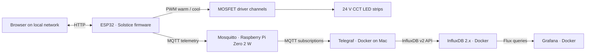

# Solstice ☀️

**Created and developed by [Ginoy George](https://www.linkedin.com/in/ginoygeorge/)**

**An ESP32-powered tunable-white LED controller with sunset automation and end-to-end MQTT observability.**

Solstice started as a DIY ambient-lighting project: control the brightness and color temperature of 24 V CCT LED strips through a local web interface. It has grown into a small, observable IoT system combining embedded firmware, a Raspberry Pi MQTT broker, Telegraf, InfluxDB, and Grafana.

The project emphasizes **local control, graceful handling of MQTT outages, and visibility into device behavior** rather than dependence on a cloud lighting platform.

> **Project status:** Working personal prototype. The ESP32 controller, local web UI, sunset schedule, MQTT telemetry, InfluxDB ingestion, and Grafana dashboard have been tested in the author's setup. Public reproduction instructions and configuration cleanup are in progress.

## What it does

- **Tunable white lighting:** Two PWM channels control warm- and cool-white outputs, with brightness from **0–100%** and color temperature from **2700–6500 K**.
- **Local web control:** Turn lights on/off, change brightness and color temperature, choose preset scenes, and configure sunset lighting settings from a browser.
- **Sunset automation:** Turn on at calculated local sunset with configurable brightness/color temperature, and turn off at **11:00 PM**. The schedule supports a manual override for the current day.
- **Smooth transitions:** PWM output gradually approaches each new target rather than changing abruptly.
- **Saved preferences:** Key lighting and schedule settings are persisted in ESP32 nonvolatile storage using `Preferences`.
- **MQTT state and events:** Publish retained state/settings snapshots plus discrete ON/OFF and adjustment events.
- **Health telemetry:** Publish firmware version, uptime, Wi-Fi RSSI, free heap, MQTT connection status, power state, brightness, and Kelvin approximately every **60 seconds** while connected.
- **Observability:** Telegraf consumes MQTT messages, stores measurements in InfluxDB 2.x, and Grafana presents current values, trends, and event history.
- **MQTT outage tolerance:** Connection attempts are bounded and retried; a small in-memory queue buffers recent events while the broker is unavailable. The local lighting UI remains usable if MQTT is down.

## System architecture



For more details:
- [System Architecture](docs/architecture.md)
- [Hardware and Wiring](docs/hardware.md)

**Control plane:** The browser communicates directly with the ESP32 over the local network. **Telemetry plane:** The ESP32 publishes MQTT messages; collection, storage, and dashboards run separately. Losing the broker should not prevent basic local light control.

## Hardware

| Component | Purpose |
| --- | --- |
| ESP32 development board (ESP32-WROOM-based build) | Wi-Fi, web server, automation, and PWM control |
| 24 V, 3-wire CCT FCOB LED strips (common positive, warm and cool channels) | Tunable-white ambient lighting; two strips wired in parallel in the current installation |
| 2 × suitable logic-level N-channel MOSFETs (IRLB8721 used in the prototype) | Low-side switching for warm and cool channels |
| 24 V DC power supply, sized for the total strip load | LED power |
| MP1584 buck converter | Supplies regulated low-voltage power to the controller |
| Common-ground wiring, suitable resistors/capacitors, connectors, and enclosure | Power distribution and switching circuit |
| Raspberry Pi Zero 2 W | Hosts the Mosquitto MQTT broker |
| Mac running Docker Desktop | Hosts Telegraf, InfluxDB, and Grafana |

### Controller wiring, conceptually

- Connect the LED strip's **24 V positive** lead to the 24 V supply positive.
- Switch the **warm** and **cool** negative channels separately through their MOSFETs.
- In the current firmware, the PWM pins are **GPIO 19 (warm)** and **GPIO 21 (cool)**.
- Connect the ESP32/controller ground, MOSFET source grounds, buck-converter ground, and 24 V supply negative to a **common ground**.
- Feed the ESP32 from an **appropriate regulated supply input**; do **not** apply 24 V directly to an ESP32 pin or 3.3 V rail.

> **Electrical safety:** Confirm the LED strips' pinout, MOSFET gate drive and thermal limits, wire gauge, fuse/protection needs, power supply capacity, and buck-converter output **before powering the circuit**. This is a low-voltage hobby prototype, not a certified mains-wiring design. A full, reviewed wiring schematic is planned for `docs/wiring.md`.

## Project layout

```text
solstice-iot/
├── README.md
├── LICENSE                         # add after selecting a license
├── .gitignore
├── firmware/
│   └── solstice.ino                # latest reviewed, sanitized firmware
├── docker/
│   ├── compose.yaml
│   ├── telegraf.conf
│   └── .env.example                # placeholders only; never real credentials
├── dashboards/
│   └── solstice-observability.json # exported Grafana dashboard
├── docs/                            # architecture, wiring, setup notes
└── images/                          # installation and dashboard photos
```

The public release should contain only files that exist and have been reviewed. Some paths above are publication targets and may not be populated yet.

## Software requirements

- **Arduino IDE 2.x** (or an equivalent ESP32-compatible build workflow)
- **ESP32 Arduino board support** and the **PubSubClient** library
- Wi-Fi network accessible to the ESP32 and MQTT broker
- **Mosquitto** MQTT broker (running on a Raspberry Pi Zero 2 W in this build)
- **Docker Desktop** and Docker Compose for the monitoring stack
- **InfluxDB 2.x**, **Telegraf 1.36.x**, and **Grafana** via the Compose setup

The firmware uses Arduino ESP32 libraries such as `WiFi`, `WebServer`, `ESPmDNS`, and `Preferences`. It contains compatibility branches for PWM APIs in different ESP32 Arduino core major versions. Exact tested dependency versions should be recorded before tagging a release.

## Getting started

### 1. Review and configure the firmware

Open the sanitized sketch under `firmware/` in Arduino IDE. Arduino IDE may ask you to place the sketch in a folder of the same base name (for example, `solstice/solstice.ino`).

Set the local configuration values required by the current sketch:

- Wi-Fi SSID and password
- MQTT broker hostname/IP, username, and password
- Setup access-point password
- Time zone and **approximate** latitude/longitude for sunset calculations
- GPIO assignments if your wiring differs

**Important:** The current firmware revision keeps these values near the top of the sketch. Before making the source public, replace any real values with placeholders or refactor into a `config.h` excluded from Git plus a `config.example.h` containing only examples. Never commit actual credentials or precise home coordinates.

Build and flash the sketch to the ESP32, then open the Serial Monitor at **115200 baud** to check Wi-Fi and MQTT connection messages.

### 2. Open the local lighting interface

On a device connected to the same local network, try:

```text
http://solstice.local
```

If mDNS name resolution is unavailable on your network, use the ESP32's IP address shown in the Serial Monitor instead. The built-in HTTP API includes `/api/state`, which returns a JSON snapshot of the controller's current settings.

The firmware also provides a setup access-point fallback when its initial Wi-Fi connection fails. This is not a full captive-portal provisioning workflow: Wi-Fi credentials are configured in the sketch.

### 3. Set up Mosquitto

Run an MQTT broker reachable from the ESP32 and Telegraf. The prototype uses Mosquitto on a Raspberry Pi Zero 2 W with username/password authentication.

Update the firmware and `docker/.env` to use your broker host and credentials. Do not expose port `1883` directly to the public internet; the current deployment is intended for a trusted local network.

To observe incoming messages from a machine with Mosquitto client tools installed:

```bash
mosquitto_sub -h YOUR_BROKER_IP -u YOUR_MQTT_USER \
  -t 'home/solstice/#' -v
```

The command prompts for a password only if your MQTT client supports that mode; otherwise supply authentication using a secure mechanism appropriate to your environment. Avoid placing real passwords in committed scripts or shell history.

### 4. Start the observability stack

Create a private environment file from the example:

```bash
cd docker
cp .env.example .env
```

Edit `.env` with real values **locally**. Variable names used by the current Compose/Telegraf setup include:

```dotenv
INFLUX_USER=CHANGE_ME
INFLUX_PASSWORD=CHANGE_ME
INFLUX_TOKEN=CHANGE_ME
MQTT_HOST=YOUR_BROKER_IP
MQTT_USER=CHANGE_ME
MQTT_PASSWORD=CHANGE_ME
TELEGRAF_INFLUX_TOKEN=CHANGE_ME
GRAFANA_ADMIN_PASSWORD=CHANGE_ME
```

Use the actual values required by the checked-in `compose.yaml`. For InfluxDB, the setup uses an organization and bucket named **`solstice`**.

Start the services:

```bash
docker compose config --quiet
docker compose up -d
docker compose ps
```

Default local web interfaces in this setup:

| Service | Local URL |
| --- | --- |
| InfluxDB | `http://localhost:8086` |
| Grafana | `http://localhost:3000` |

Grafana's InfluxDB **Flux** data source should point to `http://influxdb:8086` *inside Docker*, with organization `solstice`, bucket `solstice`, and a scoped **read-only** API token. Telegraf should have a separate token with the required **write** permission.

> **Existing installations:** Do not run a fresh InfluxDB initialization over existing volumes or remove Docker volumes when updating this project. Protect and back up your existing data first.

### 5. Import the Grafana dashboard

If `dashboards/solstice-observability.json` has been exported, import it through Grafana's dashboard UI and select your Flux data source. Otherwise, create panels using the measurements below.

Current dashboard visualizations include lighting power state, brightness, Kelvin, Wi-Fi RSSI, free heap, device uptime, and lighting event history. Health snapshots are sampled periodically, so readings can be up to about a minute behind the physical controller.

## MQTT topic reference

| Topic | Type | Payload / purpose |
| --- | --- | --- |
| `home/solstice/state` | Retained | `ON` or `OFF`; latest published power state |
| `home/solstice/availability` | Retained | `ONLINE` / `OFFLINE` broker-availability indication (uses a Last Will) |
| `home/solstice/settings` | Retained | JSON snapshot of `power`, `brightness`, `kelvin` |
| `home/solstice/events` | Event | JSON ON/OFF transitions, with `state`, `source`, `timestamp`, `sequence` |
| `home/solstice/adjustments` | Event | JSON adjustment records with `type`, `previous`, `value`, `source`, `timestamp`, `sequence` |
| `home/solstice/telemetry` | Periodic | JSON device-health snapshot, approximately once per minute while connected |

Example **health telemetry** (illustrative values):

```json
{
  "firmware": "4.2-mqtt-resilience",
  "uptime_seconds": 3600,
  "wifi_rssi_dbm": -58,
  "free_heap_bytes": 185320,
  "mqtt_connected": true,
  "power": "ON",
  "brightness": 75,
  "kelvin": 3500
}
```

Example **adjustment event**:

```json
{
  "type": "brightness",
  "previous": 70,
  "value": 75,
  "source": "manual",
  "timestamp": 1792200000,
  "sequence": 12
}
```

Event timestamps are Unix seconds. A retained settings snapshot is useful for learning the latest published settings; the event topics describe **changes over time**. The two formats intentionally serve different purposes.

### Time-series storage

Telegraf's MQTT consumers transform JSON into InfluxDB measurements:

| InfluxDB measurement | Source |
| --- | --- |
| `solstice_events` | `home/solstice/events` |
| `solstice_adjustments` | `home/solstice/adjustments` |
| `solstice_health` | `home/solstice/telemetry` |

Example Flux query for Wi-Fi RSSI in Grafana:

```flux
from(bucket: "solstice")
  |> range(start: v.timeRangeStart, stop: v.timeRangeStop)
  |> filter(fn: (r) => r._measurement == "solstice_health")
  |> filter(fn: (r) => r._field == "wifi_rssi_dbm")
  |> aggregateWindow(every: v.windowPeriod, fn: mean, createEmpty: false)
```

**Note:** Only fields explicitly configured in Telegraf's JSON parser are written to InfluxDB. For example, the `power` field must be included in the telemetry parser to support a current-light-state Stat panel.

## Reliability and design decisions

1. **Local-first control.** The ESP32 hosts the UI and drives PWM independently of the monitoring containers.
2. **Separate commands and telemetry.** Browser actions use the local HTTP API; MQTT is used for published state and observability.
3. **Retained snapshots + event history.** Latest-value topics support state inspection, while non-retained events support analysis of transitions.
4. **Bounded MQTT reconnection.** The firmware retries broker connections rather than continuously blocking the main loop.
5. **Best-effort buffering, not guaranteed delivery.** Recent power and adjustment events are held in separate in-memory queues of up to 16 entries each. The oldest entries may be dropped if a queue fills; queued data is lost on reboot, and MQTT publishes use QoS 0. InfluxDB history is therefore **not a lossless audit log**.
6. **Observability without device dependence on Grafana.** Collection and dashboard failures should not stop lighting control.

The project is designed for learning and iteration. It does not currently claim hardened authentication for the local HTTP controls, encrypted MQTT transport, production-grade persistence, or guaranteed event delivery.

## Troubleshooting

| Symptom | What to check |
| --- | --- |
| `solstice.local` doesn't resolve | Check the ESP32 IP in Serial Monitor and open `http://<ESP32_IP>` directly; mDNS support varies by network/client. |
| Web UI slows when broker is down | Confirm the resilience firmware revision and MQTT connection timeouts are in use. |
| Telegraf isn't ingesting events | Check Mosquitto access, credentials, subscribed topics, Telegraf logs, and JSON field mappings. |
| Grafana reports no data | Check dashboard time range, Flux query, field name, token permissions, and whether new MQTT telemetry has actually arrived. |
| Grafana cannot connect to InfluxDB | From Grafana's container, use `http://influxdb:8086`, not `localhost:8086`. |
| Sunset time looks wrong | Verify the time zone, configured location, NTP synchronization, and whether daylight saving time is in effect. |

Useful diagnostics:

```bash
cd docker
docker compose ps
docker compose logs --tail=50 telegraf
docker compose logs --tail=50 influxdb
docker compose logs --tail=50 grafana
```

## Roadmap

- [ ] Publish a reviewed hardware schematic, bill of materials, and assembly photos
- [ ] Refactor local settings into an ignored credentials/configuration file
- [ ] Pin and document tested Arduino dependencies and Docker image versions
- [ ] Export and verify a portable Grafana dashboard JSON
- [ ] Add richer device health signals (minimum free heap, largest allocatable block, restart cause)
- [ ] Add device offline/restart detection and useful Grafana alerts
- [ ] Evaluate OTA updates and secure provisioning
- [ ] Write a technical build article documenting lessons learned

## Security and privacy

Never commit `docker/.env`, Wi-Fi or MQTT passwords, InfluxDB tokens, private hostnames, or precise home coordinates. Use `.env.example` and other placeholder-based configuration templates. Keep Grafana and InfluxDB bound to localhost or otherwise protected as appropriate, and keep Mosquitto accessible only on a trusted network unless you've deliberately configured secure remote access.

Before changing a GitHub repository from private to public, inspect **all committed files and commit history** for secrets. Removing a value from a later commit does not remove it from Git history.

## Author

**Ginoy George** — creator and developer of Solstice.

This project documents my hands-on exploration of embedded electronics, local-first automation, MQTT messaging, resilient IoT systems, and observability.

## License

A license has **not yet been selected** for publication. Add an appropriate `LICENSE` file before inviting contributions or reuse; until then, standard copyright restrictions apply.

---

*Solstice · Designed and developed by [Ginoy George](https://www.linkedin.com/in/ginoygeorge/).*
