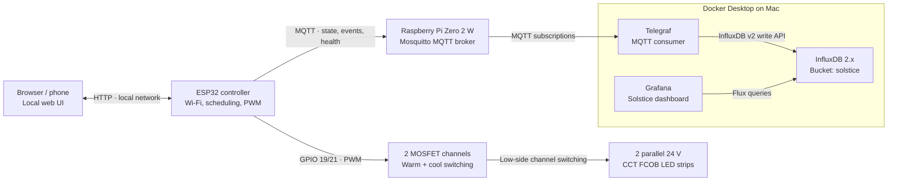

# Solstice — System Architecture

**Project:** Solstice IoT Smart Ambient Lighting  
**Author:** [Ginoy George](https://www.linkedin.com/in/ginoygeorge/).  
**Status:** Working personal prototype; documentation for public release

## Overview

Solstice is a local-first, tunable-white LED controller built around an ESP32 development board. The ESP32 operates the lighting independently of the monitoring stack; MQTT transports state changes and device telemetry to a Raspberry Pi, where Telegraf subscribes and forwards data to InfluxDB. Grafana reads that time-series data to display device health and lighting activity.

There are two distinct paths:

- **Control path:** A web browser sends HTTP requests directly to the ESP32, which drives PWM outputs for the LED strips.
- **Observability path:** The ESP32 publishes MQTT messages to Mosquitto. Telegraf writes parsed measurements to InfluxDB, and Grafana queries InfluxDB.

The observability path is **not required for the lights to operate**.

## Architecture diagram



The LED power supply, buck converter, and common-ground wiring are documented separately in [Hardware](hardware.md). Both LED strips are connected in parallel and respond to the same warm/cool PWM channels.

## Components and responsibilities

| Component | Responsibility | Deployment |
| --- | --- | --- |
| ESP32 firmware | Browser UI, PWM outputs, light scenes, sunset calculation, 11 PM shutoff, saved preferences, MQTT publication | Embedded controller |
| MOSFETs + 24 V CCT LED strips | Switch warm/cool channels and produce tunable-white illumination | Physical installation |
| Mosquitto | Receives MQTT publications and supports availability / retained-state topics | Raspberry Pi Zero 2 W |
| Telegraf | Subscribes to selected MQTT topics; parses JSON into measurements | Docker on Mac |
| InfluxDB 2.x | Stores event and health time-series measurements in bucket `solstice` | Docker on Mac |
| Grafana | Queries InfluxDB and visualizes light activity and device health | Docker on Mac |

## Control path

1. The ESP32 joins the configured Wi-Fi network and serves an HTTP interface at its local IP address; `http://solstice.local` works when mDNS resolution is available.
2. A browser reads `/api/state` and sends changes to `/api/set` for power, brightness, color temperature, scenes, and automation settings.
3. Firmware converts the desired brightness and approximate color-temperature setting into PWM duty cycles for two channels.
4. PWM outputs on **GPIO 19 (warm)** and **GPIO 21 (cool)** drive the external switching hardware.
5. Changes to key preferences are persisted using the ESP32 `Preferences` API after a short debounce.

The firmware implements gradual fades instead of immediate PWM steps. The web interface is **local HTTP without application-layer authentication** in this prototype; it must remain on a trusted network.

## Scheduling and local behavior

- Lighting can turn on at an **approximate calculated local sunset**, using configured latitude/longitude and time-zone rules.
- A scheduled shutoff occurs at **11:00 PM local time**.
- Scheduled brightness and Kelvin are configurable separately from the current manual settings.
- Manual changes can override the schedule for the remainder of the local day.
- Correct scheduling requires valid wall-clock time synchronized using NTP.

Location and time-zone values are configuration data: replace the example location in public source with your own **approximate** location when deploying.

## MQTT data contracts

| Topic | Retained? | Content |
| --- | --- | --- |
| `home/solstice/state` | Yes | `ON` or `OFF` |
| `home/solstice/availability` | Yes | `ONLINE` or `OFFLINE` via broker Last Will behavior |
| `home/solstice/settings` | Yes | JSON snapshot: `power`, `brightness`, `kelvin` |
| `home/solstice/events` | No | JSON power transitions: `state`, `source`, `timestamp`, `sequence` |
| `home/solstice/adjustments` | No | JSON changes: `type`, `previous`, `value`, `source`, `timestamp`, `sequence` |
| `home/solstice/telemetry` | No | Periodic JSON health snapshot, approximately every 60 seconds while MQTT is connected |

Example health message (illustrative numbers):

```json
{
  "firmware": "4.2-mqtt-resilience",
  "uptime_seconds": 3600,
  "wifi_rssi_dbm": -58,
  "free_heap_bytes": 180000,
  "mqtt_connected": true,
  "power": "ON",
  "brightness": 70,
  "kelvin": 3000
}
```

Example adjustment event:

```json
{
  "type": "color_temperature",
  "previous": 3000,
  "value": 3500,
  "source": "manual",
  "timestamp": 1792200000,
  "sequence": 12
}
```

`timestamp` is Unix time in seconds. `sequence` is a firmware-side counter, **not** a globally unique or reboot-persistent identifier. Event payloads record the time of an observed change, but downstream time-series ingestion may also assign an ingestion timestamp. These clocks should not be assumed identical.

## From MQTT to Grafana

The Telegraf configuration converts MQTT messages into these InfluxDB measurements:

| Measurement | Input topic | Example fields |
| --- | --- | --- |
| `solstice_events` | `home/solstice/events` | `state` |
| `solstice_adjustments` | `home/solstice/adjustments` | `previous`, `value` |
| `solstice_health` | `home/solstice/telemetry` | `uptime_seconds`, `wifi_rssi_dbm`, `free_heap_bytes`, `power`, `brightness`, `kelvin` |

Grafana uses an InfluxDB data source configured for **Flux**. The Docker-internal InfluxDB URL is `http://influxdb:8086`; `localhost:8086` is the address to use from the host Mac, not from the Grafana container. See [`../docker/`](../docker/) for the Compose and Telegraf configuration, and [`../dashboards/`](../dashboards/) for the exported Grafana dashboard.

### Example: current heap value

```flux
from(bucket: "solstice")
  |> range(start: -5m)
  |> filter(fn: (r) => r._measurement == "solstice_health")
  |> filter(fn: (r) => r._field == "free_heap_bytes")
  |> group()
  |> last()
```

A recent reading tells you the last *reported* heap value; it is not proof of continuous connectivity. For device-offline detection, use **last-telemetry age** or a monitored broker-availability topic rather than assuming the `mqtt_connected` value alone can show disconnections. A disconnected device cannot send a new health reading saying it is disconnected.

## Resilience and delivery semantics

The current resilience firmware was designed so MQTT failures do not make local lighting unusable:

- Broker reconnection attempts are spaced approximately **15 seconds** apart.
- Client network and MQTT socket timeouts are bounded to reduce blocking.
- Power-state transitions and setting adjustments have **separate RAM buffers with up to 16 entries each**.
- On reconnection, the firmware attempts to publish queued changes and refreshes retained snapshots.
- When queues fill, the oldest buffered records can be dropped; all buffered records are lost on restart.
- The firmware's MQTT publishes use **QoS 0**, so successful client calls do **not** guarantee ingestion or durable persistence.

**Design tradeoff:** The project favors a responsive local controller over guaranteed telemetry delivery. InfluxDB should be treated as best-effort observability, **not** an authoritative audit log.

## Failure scenarios

| Failure | Expected behavior / limitation |
| --- | --- |
| Mosquitto unavailable | Local browser control and PWM continue; MQTT retries; events buffer temporarily within RAM limits |
| Telegraf or InfluxDB unavailable | Lighting continues; MQTT may still reach the broker, but historical records can be missing |
| Grafana unavailable | Lighting and telemetry pipeline continue; dashboards are unavailable |
| Wi-Fi unavailable at boot | Firmware exposes a fallback access point, but this is not a complete captive-portal provisioning system |
| Device restart | Preferences reload; transient telemetry queues and sequence counters do not persist |
| No NTP synchronization | Sunset scheduling waits for a valid clock; local manual lighting control remains independent |

## Security boundaries

This is a home-LAN prototype, not a hardened internet-facing service. Keep the local HTTP UI, MQTT broker, Grafana, and InfluxDB behind appropriate network access controls. Do not expose the ESP32 HTTP interface or plaintext MQTT directly to the internet. Never commit Wi-Fi credentials, MQTT passwords, access-point passwords, InfluxDB tokens, or precise home location data. Review the Git history as well as the latest files before making the repository public.

## Planned improvements (not yet implemented)

- Device offline / reboot detection and alert rules
- More detailed memory diagnostics (minimum free heap, largest free block)
- OTA updates and safer device provisioning
- Better delivery assurance if the project ever needs lossless event history
- Reviewed physical wiring schematic and reproducible build validation

---

*Solstice — designed and developed by [Ginoy George](https://www.linkedin.com/in/ginoygeorge/).*
