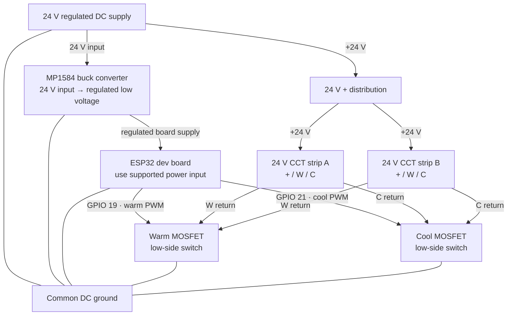

# Solstice — Hardware and Wiring Overview

**Project:** Solstice IoT Smart Ambient Lighting  
**Author:** [Ginoy George](https://www.linkedin.com/in/ginoygeorge/).  
**Status:** Prototype documentation

## Build summary

Solstice drives **two 24 V, three-wire CCT (tunable-white) FCOB LED strips** connected in parallel. The strips share a positive supply connection and have separate **warm (W)** and **cool (C)** channels. An ESP32 uses two PWM signals to control external N-channel MOSFETs. A DC-DC buck converter supplies regulated low-voltage power to the development board.

This document records the known electrical design and places that still require measurement or inspection. It is **not yet a verified point-to-point wiring schematic**.

## Hardware inventory

| Component | Prototype / known detail | Role |
| --- | --- | --- |
| ESP32 development board | ESP32-WROOM | Wi-Fi, HTTP web interface, scheduling, PWM, MQTT |
| LED strips | 2 × 24 V CCT FCOB, common positive with separate C and W connections; installed parallel | Tunable-white light output |
| MOSFETs | 2 × IRLB8721 N-channel MOSFETs | Switch the warm and cool return channels |
| Buck converter | MP1584 module, adjusted around 5.0 V in the prototype | Steps 24 V down to the board's supported supply input |
| Power supply | Regulated 24 V DC; verify the nameplate current capacity | Powers both LED strips and the buck input |
| Power distribution | Terminal blocks, wiring, prototype board, resistors/capacitors | Physical connections and gate control network |
| MQTT computer | Raspberry Pi Zero 2 W | Runs Mosquitto; **not part of the LED power circuit** |
| Observability computer | Mac running Docker Desktop | Runs Telegraf, InfluxDB, and Grafana |


## Electrical block diagram



The diagram is **conceptual**, not an assembly drawing. In a conventional low-side arrangement, the MOSFETs' **drains** connect to their respective LED-channel return conductors and their **sources** connect to the shared supply negative. MOSFET **gates** are driven from the ESP32 PWM outputs through a suitable, reviewed gate-drive network. Confirm the exact device pinout against the component datasheet before wiring; physically adjacent leads do not imply a particular pin assignment.

## Firmware pin assignments

Solstice resilience firmware defines:

```cpp
const int COOL_PIN = 21;
const int WARM_PIN = 19;
const int PWM_HZ = 5000;
const int PWM_BITS = 8;
```

| Firmware signal | ESP32 GPIO | Intended output |
| --- | --- | --- |
| `WARM_PIN` | GPIO 19 | Warm channel MOSFET gate drive |
| `COOL_PIN` | GPIO 21 | Cool channel MOSFET gate drive |
| Ground | GND | Reference for MOSFET gate voltage and power supplies |

**Board-specific caution:** GPIO availability and special functions vary between ESP32 development boards. In particular, GPIOs used for native USB on some ESP32-S3 boards should be checked before adopting this mapping. This repository must identify the exact board and its verified pin assignments instead of assuming every ESP32 variant is interchangeable.

## Why the strips are in parallel

Each strip receives the same +24 V rail. The warm connections are joined into a warm-channel return path, and the cool connections are joined into a cool-channel return path. Both warm paths are switched by the same warm MOSFET; both cool paths by the same cool MOSFET. Therefore both strips follow the same power, brightness, and Kelvin settings.

This arrangement **adds current demand** on the supply and MOSFET channels. It does not double the supply voltage requirement.

## Supply sizing example

The LED strips are approximately **10 W/m** with about **18 ft combined installed length**.

```text
18 ft × 0.3048 m/ft = 5.4864 m
5.4864 m × 10 W/m   ≈ 54.9 W nominal strip load
54.9 W ÷ 24 V       ≈ 2.29 A nominal strip current
```

These values exclude buck-converter input power, conversion losses, startup behavior, and uncertainty in the strip rating. A **24 V / 2.5 A (60 W)** supply would have little headroom at this nominal load. A supply with suitable additional margin (for example, around **24 V / 4 A or greater**, *provided all load and safety specifications are checked*) is more comfortable for this example. The actual selected supply should be based on measured draw and the strip manufacturer's maximum-power specification.


## MOSFET and gate-drive considerations

The IRLB8721 devices switch the strip's warm and cool current paths. This is a low-side switching topology and depends on a correct **common ground**.

Before finalizing a public schematic, verify all of the following against the installed build and the MOSFET datasheet:

- The MOSFET is adequately enhanced by the ESP32's **3.3 V GPIO high level** at the required channel current. The term “logic-level” by itself is not proof of adequate performance at 3.3 V.
- Gate resistor and gate pull-down resistor values and locations are appropriate. A pull-down helps keep the LEDs off while the controller starts or its pins are high impedance.
- Voltage, current, and thermal ratings have adequate margin; test device temperature after sustained operation.
- PWM switching remains stable and does not exceed board GPIO current specifications.
- Conductors and terminal blocks can carry the full load; add appropriate wiring protection and strain relief.

Color-temperature control here is an **open-loop warm/cool PWM mix**, not a colorimetrically calibrated Kelvin output. The displayed Kelvin value represents the requested setting, and the actual light color depends on the LED strip and mixing characteristics.

## Buck converter and controller power

The MP1584 buck module takes the 24 V supply as input and supplies a lower regulated voltage to the controller. In the prototype, the output was adjusted to approximately **5.01 V** before connecting the board.

- Measure buck output voltage **with a meter before attaching the ESP32**.
- Connect it only to a power input rated for that voltage on the **specific development board**, following the board's schematic or manufacturer instructions.
- **Never connect 24 V** directly to the ESP32's GPIO, 3.3 V pin, or other unsupported power pins.
- Tie the controller ground to the common DC ground reference.
- Check capacitor polarity and rated voltage, especially on the 24 V side.
- Confirm how USB power and the buck input interact before powering a board from both simultaneously.

## Pre-power inspection checklist

1. Disconnect all power and verify the 24 V / ground polarity at the distribution terminals.
2. Confirm both LED strips' labels and pinouts: `+24 V`, `W`, and `C`.
3. Verify MOSFET **gate, drain, and source** using the exact installed part's datasheet.
4. Verify GPIO-to-channel assignment and that gate-drive wiring cannot accidentally connect 24 V to the ESP32.
5. Confirm the supply, connector, and wire current ratings are adequate for **both** strips.
6. Power and test the buck converter separately, confirming the output voltage and polarity.
7. Verify common-ground continuity and check for unintended short circuits.
8. Test each PWM channel at low brightness first, then check sustained-load temperatures and supply voltage.

This work should remain limited to properly enclosed low-voltage circuits. **Mains AC wiring and permanent household electrical installations require appropriately rated equipment and qualified installation as applicable.**


## Firmware and further reading

- [Solstice firmware](../firmware/solstice.ino)
- [System architecture](architecture.md)
- [Repository README](../README.md)

---

*Solstice — designed and developed by [Ginoy George](https://www.linkedin.com/in/ginoygeorge/).*
